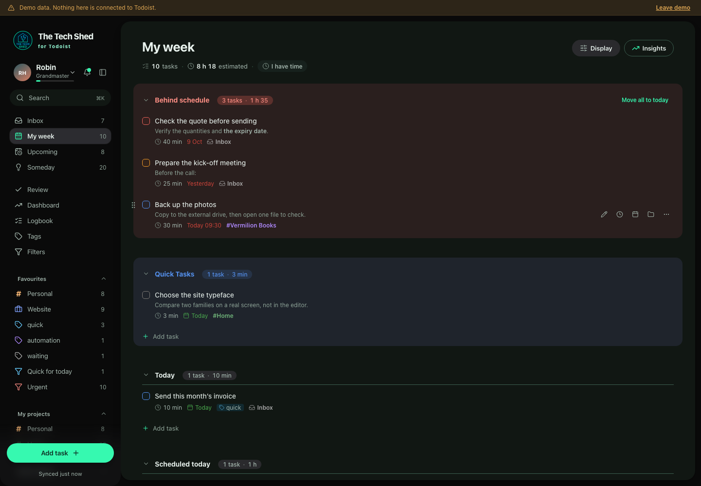

# The Tech Shed for Todoist

A local-first weekly planner, maintained by [The Tech Shed](https://thetechshed.dev).
Connect Todoist, plan your week, estimate tasks and review what matters. Runs in the browser; there is no application backend.

Forked from [Enhanced for Todoist](https://github.com/julesvbertolino/todoist-enhanced) by Jules-Valentin Bertolino. The original MIT licence and copyright are retained in [LICENSE](LICENSE). See [NOTICE](public/NOTICE.txt).



See [fork notes and validation](docs/FORK.md) for scope and the known upstream browser-test failure.

## Run locally

Use Node 22 or later:

```sh
npm ci
npm run dev
```

Open http://127.0.0.1:5192/ and try the demo. For a real account, use your personal Todoist API token. Never commit a token. Credentials stay in this browser and are sent to Todoist; cached tasks and the offline outbox use IndexedDB.

## Build and self-host

```sh
PUBLIC_URL=https://your-domain.example/ npm run build
npm run preview -- --host 127.0.0.1
```

Use your actual HTTPS app address (including any subfolder). Todoist OAuth requires the generated `oauth/client.json` to be publicly reachable there. No hosted instance or branded desktop binary is provided by this fork. Without PUBLIC_URL, the build targets local development and API-token sign-in; do not deploy that OAuth metadata.

Upload the complete `dist/` folder. On Apache, include `.htaccess`. Other hosts must apply equivalent security headers from `vite.config.ts`. Retain `LICENSE` and `NOTICE.txt` in every distribution. `npm run package` builds a verified ZIP; set PUBLIC_URL for that command too.

## Validation

```sh
npm run typecheck
npm run lint
npm test
npm run build
npx playwright install chromium
npm run e2e
```

## Fork changes

- The Tech Shed name, supplied logo, green/charcoal theme, app icons and project links.
- Failed outbox writes report an error without presenting an edit as safely queued.
- Sign-out cancels delayed persistence and ignores stale sync/write responses.
- OAuth exchange and refresh have deadlines covering response bodies; refresh can be retried after a timeout.
- Feedback goes to this fork. Upstream recruitment, donation prompts and desktop download promotion are removed from active UI.

Report problems in [this repository](https://github.com/willcurtis/todoist-enhanced/issues). Historic changelogs describe upstream releases, not verified releases of this fork.

Independent of Todoist: not created by, affiliated with, or supported by Todoist. Todoist is a trademark of Todoist Inc.
